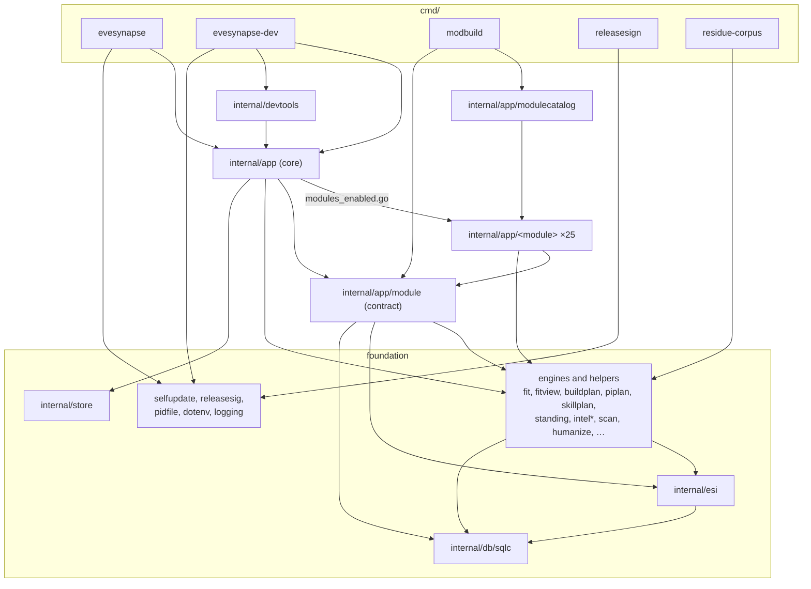
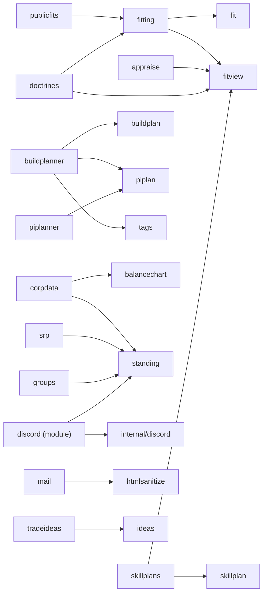
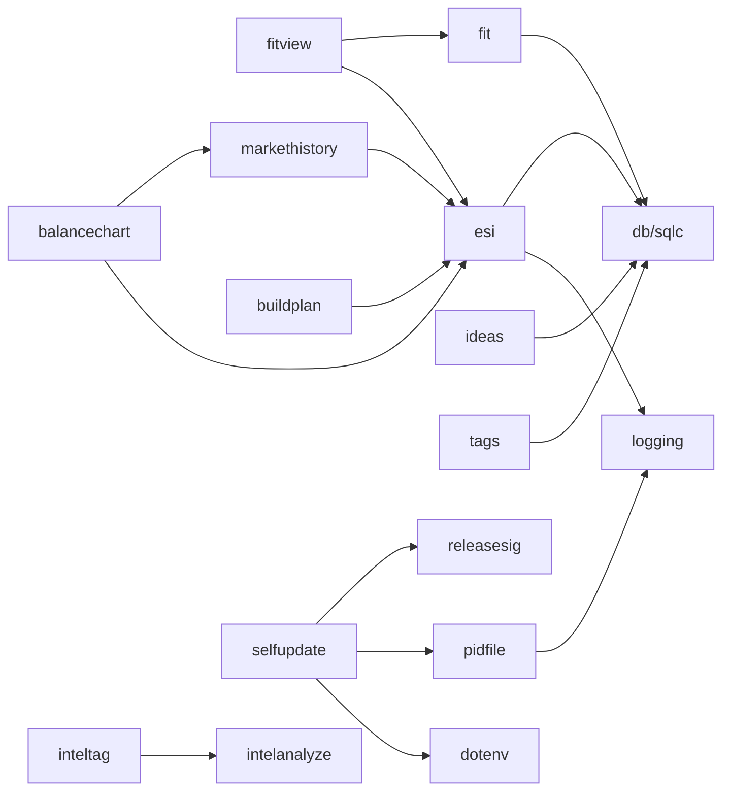

# EveSynapse (Go rewrite)

EveSynapse is a lightweight and fast, yet comprehensive and powerful all-in-one EVE Online companion (character sheets, market, fitting, intel, industry, etc) rebuilt in Go on CCP/Fenris Creation's ESI API with EVE SSO login.

The modernization is developed by natemsz (Nate / IGN: Burzrujat), rewriting the original Python-based closed-source app module by module in Go. Not all modules have been finished but development is very active. Built in the hopes it might be useful to the players of this game that holds a special place in my heart and other third party developers for their own projects.

EveSynapse is based on the 2013 project originally developed by natemsz, element, and j0ker (Rest in peace Matt. See you on the other side of the Eve Gate). Without them, the original project would not have been possible and this rewrite would not exist. While they have not contributed to the modernization, their work was critically important to both it's development and to my skills as a developer today. 

Special thanks to Sahir and ado for helping me fix my own mistakes and answering questions, and to Marti for putting up with me and my constant requests to test out features.

This project is dedicated to EVE Online, the game and community that I have loved for over two decades. To its pilots and its developers, past, present, and future; and to all those who we have lost over the years o7.

While there is a hosted version (https://evesynapse.app) you are welcome to install this on your local machine or as a corporation/alliance service (see below on how to restrict sign-ups). If you have suggestions, concerns, questions or complaints, feel free to shoot us an email.

Contact: admin@evesynapse.app (the team), nate@evesynapse.app (Nate, or in-game 'Burzrujat'), miko@evesynapse.app (Miko). Bugs, issues and security reports go to bugs@evesynapse.app (see SECURITY.md).

## Repository

The project's main home is on Forgejo at [natems.dev/EveSynapse/evesynapse](https://natems.dev/EveSynapse/evesynapse). Development, issues, and pull requests happen there. The project is mirrored at [GitHub](https://github.com/natemsz/evesynapse) and [GitLab](https://gitlab.com/natemsz/evesynapse); the mirrors are read-only copies and may lag the main home.

## AI Use Disclosure and Policy
- AI is used in this project purely for security auditing, hardening, and performance improvements, writing tests, certain UI elements such as icons and glyphs (I'm no artist), and to assist with simplifying repetitive tasks. AI is a force multiplier, never a primary un-reviewed author. If you wish to contribute code to the project you must:

1. Understand the code you are submitting. Your name is on it, you are responsible for it.
2. Reviewed it adequately with your own brain. Mistakes are okay, but give it your best effort.
3. Never re-make what can be re-used. Familiarize yourself with the existing code-base first.
4. Keep it consistent. Respect conventions. They are there for a reason. If you think something can be improved and wish to make a large change, please explain why. AI is terrible with this and code submitted this way without explanation will be assumed to be breaking rules 1-3.

This is a human-built project built for other humans, and a labor of love. 

## Stack

- **Go** (module `evesynapse`; see `go.mod`)
- **chi** (`github.com/go-chi/chi/v5`) — HTTP router
- **alexedwards/scs v2** — sessions, stored in PostgreSQL via `pgxstore`
- **PostgreSQL 16** — the app's database, reached through
  **pgx/v5** (sqlc generates `database/sql` code over the pgx
  stdlib driver; a pgxpool backs the session store)
- **sqlc** — type-safe Go generated from hand-written SQL
- **golang.org/x/oauth2** — EVE SSO authorization-code flow
- **github.com/golang-jwt/jwt/v5** — SSO access-token verification
  against CCP's JWKS (issuer `login.eveonline.com`)
- **html/template** + `embed.FS` — server-rendered pages


## Documentation

The user and operator documentation lives in the
[wiki](https://natems.dev/EveSynapse/evesynapse/wiki), organized by topic:
[Features](https://natems.dev/EveSynapse/evesynapse/wiki/Features), [Installation](https://natems.dev/EveSynapse/evesynapse/wiki/Installation),
[Running](https://natems.dev/EveSynapse/evesynapse/wiki/Running), [Configuration](https://natems.dev/EveSynapse/evesynapse/wiki/Configuration),
[Updating](https://natems.dev/EveSynapse/evesynapse/wiki/Updating), [Notifications](https://natems.dev/EveSynapse/evesynapse/wiki/Notifications),
[Discord](https://natems.dev/EveSynapse/evesynapse/wiki/Discord), [Security](https://natems.dev/EveSynapse/evesynapse/wiki/Security), the
[Swarm Cache](https://natems.dev/EveSynapse/evesynapse/wiki/Swarm-Cache), and the [Frontend](https://natems.dev/EveSynapse/evesynapse/wiki/Frontend).
This README keeps the project's description, its AI use
disclosure, and the internals: the stack, the layout, and how
the running system works.

## Layout

The code is in four layers, and imports only point down:

1. **Entry points** (`cmd/`) — thin `main` packages: the server, the
   dev server and the maintainer tools.
2. **Core** (`internal/app`) — the application: sign-in, routing,
   page rendering, the background worker and every page that is not
   an optional module.
3. **Modules** (`internal/app/<module>/`) — the optional features.
   Each one is a package that registers a `module.Module` and reaches
   the rest of the app only through the contract in
   `internal/app/module` (`module.Deps`). A build contains exactly the
   modules `internal/app/modules_enabled.go` imports (see "Choosing
   the modules in a build" below).
4. **Foundation** (`internal/*`) — the database, the ESI client and
   the engines and helpers that core and modules share. Most of them
   are pure: no store, no network, no configuration.

Three rules hold across the tree, and a change that breaks one needs a
good reason:

- A module never imports core (`internal/app`) or another module.
  When one module needs another (Public Fits and Doctrines need
  Fitting) it says so in its manifest, and `cmd/modbuild` brings the
  required module into the build; there is no import between them.
- Foundation packages never import `internal/app` or a module.
  `internal/esi` in particular gets its access tokens through a
  callback.
- What core and a module both show lives in foundation (for example
  `internal/ideas` for the stored trade-ideas answer, or
  `internal/fitview` for the fit document), so that neither depends on
  the other.



The map in this section is what `go list` reports. To check it after
a change:

```sh
go list -f '{{.ImportPath}}:{{range .Imports}} {{.}}{{end}}' ./... |
  sed 's#evesynapse/##g' |
  awk -F: '{n=split($2,a," "); s=""; for(i=1;i<=n;i++) if(a[i]~/^internal\//) s=s" "a[i]; print $1":"s}'
```

### Entry points

| Package | What it is | Imports |
| --- | --- | --- |
| `cmd/evesynapse/` | the release server: thin wiring (config → app → HTTP server). It does not import `internal/devtools`, so the release binary contains no dev-login code and `DEV_LOGIN=1` has no effect on it | `app`, `logging`, `pidfile`, `selfupdate` |
| `cmd/evesynapse-dev/` | the dev server: identical wiring plus the dev-only routes (`/dev-login`). Local testing only — never deploy this binary | as above, plus `devtools` |
| `cmd/modbuild/` | the module build tool: lists the modules, what each requires and the scopes it declares, and writes `internal/app/modules_enabled.go` for a selection | `app/module`, `app/modulecatalog` |
| `cmd/releasesign/` | the maintainer's release-signing tool: makes the release key, signs the update manifests in the release job, checks a signature by hand. Never deployed | `releasesig` |
| `cmd/residue-corpus/` | builds labeled training examples for the intel residue reader from production exports (the residue calls and the reports they fed), with labels taken only from verified outcomes. A maintainer tool; never deployed | `intelanalyze` |
| `cmd/mkicons/` | draws the raster icons from the logo's SVG files in `internal/app/static/`: `logo.svg` (the mark, shown in the page header), `icon.svg` (the app icon) and `favicon.svg` (the simplified small one). To change the logo, replace those and run `go run ./cmd/mkicons`: it rewrites `favicon.ico`, the four PNG app icons and the notification badge beside them | standard library only |

### Core: `internal/app/`

The application: config + `.env` loader
(`core_config.go`), EVE SSO auth/sessions/JWT verification (`auth.go`),
account linking and the sign-up policy (`auth_links.go`, `auth_signup.go`),
token refresh and encryption at rest (`auth_refresh.go`,
`auth_tokencrypt.go`), cookie, header and cross-site protections
(`core_httpsec.go`), the application struct and router (`core_app.go`),
page handlers and view models
(`core_pages.go`, `char_assets.go`, `char_skills.go`, `corp_overview.go`,
`market.go`, `sync.go`, `char_pages.go`, `char_fittings.go`,
`char_killmails.go`, `intel.go`), the background worker (`worker.go`
runs the cycle; each `*_worker.go` file is the fetching behind one
group of pages, and `worker_name_harvest.go` collects the names a cycle
has to resolve), what pages and the worker both read
(`core_snapshots.go`, `market_book.go`), the
SDE static-data importer (`sde.go`), static assets and their
caching (`core_static.go`), the health check (`core_health.go`), and the
two maintenance modes that need the application (`core_maintenance.go`:
`-version` and `-refresh`).

It is one Go package, and a file's name starts with the part of the
app it belongs to, so a directory listing groups them. A test file
sits beside the code it tests with the same prefix.

| Prefix | What is in it |
| --- | --- |
| `core_` | the application itself: start-up, config, routing, page rendering, security headers, static files, health, maintenance |
| `auth` | EVE sign-in, sign-up policy, linking characters, token refresh and encryption |
| `ui_` | navigation state and the tests that pin layout and styling |
| `module_`, `modules_` | the module registry: which modules a build has (`modules_enabled.go`, `modules_core_only.go`), which an account has by the scopes it granted, and the `module.Deps` core hands them |
| `home_` | the home page: widgets, briefing, net worth |
| `char_` | pages about one character: sheet, skills, assets, fittings, killmails, industry |
| `economy_` | wallet, orders, contracts |
| `planets_` | planetary industry |
| `comms_` | mail, calendar, contacts |
| `profit_` | the profit pages: per-item trading and per-blueprint industry profit and loss, and their charts |
| `truevalue` | true values: the bottom-up price for manufacturable items and the learned price for contract-only ships |
| `pub_` | public contracts: the worker's mirror of ESI's public contracts and the confirmed sales taken from it |
| `map_` | the star map: systems, routes, character and intel layers |
| `corp_` | corporation pages and special-interest groups |
| `ops_` | the op calendar and attendance |
| `market_` | market pages, scanners, price guide, restock |
| `items_` | the item database |
| `intel_` | wars, incursions, pilots, corporations, alliances, places |
| `battle_` | battle reports: fights posted by Axon, joined to their killmails, with findings and a timeline |
| `structures_` | structures |
| `search_` | search |
| `stats_` | the Admin analytics recorder and its charts |
| `fetch_` | per-character ESI fetch policy: refusals, gates, and the freshness each page shows |
| `sde` | the static-data importer |
| `sync` | the Sync page |
| `notify_` | notifications and browser push |
| `worker_` | the background worker: the cycle, tiers, lanes, timing, name warm-up |

A `*_worker.go` file under another prefix is the fetching behind
that group of pages. Beside the Go files:

- `internal/app/templates/` — embedded html/templates (`base.html`
  layout)
- `internal/app/static/` — embedded assets: the 2013 wallpaper
  (`bg.jpg`) and the dependency-free stylesheet (`style.css`), served
  at `/static/`
- `internal/app/jstest/` — tests for the page scripts in `static/`
- `internal/app/seo/` — `robots.txt`

Core imports the module contract, every module the build selects, and
nearly all of foundation: `store`, `db/sqlc`, `esi`, `logging`,
`dotenv`, `pidfile`, the engines, and the leaf packages `webpush`,
`ocikms` (token-key wrapping), `marketwire`, `scan`,
`intelanalyze`, `intelchat` and `inteltag`.

### Modules: `internal/app/<module>/`

`internal/app/module/` is the contract between core and the modules:
the `Module` a package registers (its routes, nav entries, worker
jobs, scopes and the modules it requires) and `module.Deps`, what core
hands it at run time (the database, the ESI client, the current
character's standing, and readers for what core owns). It imports only
`db/sqlc`, `esi`, `fitview` and `standing`.
`internal/app/modulecatalog/` lists every module in nav order. Only
`cmd/modbuild` imports it, so listing a module there compiles nothing
into a build that did not choose it.

Every module imports `app/module` and `logging`; all but Intel import
`db/sqlc`, and all but Public Fits, Groups and Discord import `esi`. The table lists what each
needs beyond that. `make modules` prints the same list of requirements
and scopes from the modules themselves.

| Module id | Package | Requires module | Foundation it uses | ESI scopes it needs |
| --- | --- | --- | --- | --- |
| `buildplanner` | `buildplanner/` — Build Planner: its page, JSON payload and recipe source over the SDE | | `buildplan`, `piplan`, `humanize`, `tags` | `read_blueprints` |
| `fitting` | `fitting/` — Fitting: workbench, saved loadouts, import/export, save to the game, shopping list | | `fit`, `fitview` | `read_fittings`, `write_fittings` |
| `publicfits` | `publicfits/` — Public Fits: browser, fit pages, ratings and the jobs that keep them stored-only; the flag and storage stay core | `fitting` | (no `esi`) | |
| `skillplans` | `skillplans/` — Skill Plans: plan pages, plan-from-fit and plan editing | | `skillplan`, `fitview`, `humanize` | |
| `wallet` | `wallet/` — Wallet | | `humanize` | `read_character_wallet` |
| `mail` | `mail/` — Mail | | `htmlsanitize`, `humanize` | `read_mail`, `organize_mail`, `send_mail` |
| `calendar` | `calendar/` — Calendar | | `humanize` | `read_calendar_events`, `respond_calendar_events` |
| `contacts` | `contacts/` — Contacts | | | `read_contacts` |
| `scanner` | `scanner/` — Spread Scanner | | | |
| `tradefinder` | `tradefinder/` — Trade Finder | | | |
| `leaderboard` | `leaderboard/` — Top Stations | | | |
| `restock` | `restock/` — Restock Planner | | | |
| `market` | `orders/` — Market orders | | `humanize` | `read_character_orders`, `structure_markets` |
| `contracts` | `contracts/` — Contracts | | `humanize` | `read_character_contracts` |
| `appraise` | `appraise/` — Appraisal / Multi-Sell | | `fitview` | |
| `corpdata` | `corpdata/` — Corporation Data: member, wallet, order, asset and structure pages | | `balancechart`, `standing`, `humanize` | |
| `doctrines` | `doctrines/` — Doctrines and corporate loadouts | `fitting` | `fitview`, `humanize` | |
| `srp` | `srp/` — Ship Replacement | | `standing`, `humanize` | |
| `groups` | `groups/` — Groups | | `standing`, `humanize` (no `esi`) | |
| `discord` | `discord/` — Discord: connecting an account, the bot's servers (roles by rule, members, private channels, ops announced) and direct-message notifications | | `discord` (the API client), `standing` (no `esi`) | |
| `swarm` | `swarm/` — Shared Cache: the signed, spot-checked sharing of public data between instances (see the wiki's [Swarm Cache](https://natems.dev/EveSynapse/evesynapse/wiki/Swarm-Cache) page) | | `humanize` | |
| `intel` | `intel/` — Intel: the killboard, the d-scan and intel parsers' pages, intel channels, the synthesized feed and workbench, pilot dossiers, and the public wars, incursions and faction-warfare pages. The parsers and synthesis live in core and the `intelanalyze`/`intelchat` packages; the module is their pages | | `humanize` (no `db/sqlc`) | |
| `piplanner` | `piplanner/` — PI Planner: colony chain layouts over the SDE, beside the core colonies pages | | `piplan` | |
| `tradeideas` | `tradeideas/` — Trade Ideas: the page and the stored model answers the worker refreshes | | `ideas` | |

Scopes are shortened (`read_blueprints` is
`esi-characters.read_blueprints.v1`). A module also lists scopes it
can use but does not need, and works without them; `make modules`
shows those as "enhances".



### Foundation: `internal/`

Core imports all of these except `fit` and `piplan` (which it reaches
through `fitview` and the modules) and the update packages
`selfupdate` and `releasesig`, which only the entry points use. The
"Imports" column is the package's own internal imports; a dash means it uses the standard
library and third-party packages only.

**Data and ESI**

| Package | What it is | Imports |
| --- | --- | --- |
| `internal/store/` | the database: opens Postgres and brings the schema up to date at startup (`store.go`, `schema.go`). The schema itself is the numbered steps in `internal/store/schema_pg/`, which are also sqlc's input | — |
| `internal/db/query/` | hand-written queries (sqlc input) | |
| `internal/db/sqlc/` | sqlc-generated code (do not edit) | — |
| `internal/esi/` | the ESI client: HTTP layer, per-character snapshot cache, and the two-tier type/group/place name resolution (network tier + cache-only render tier). Never imports `internal/app`; access tokens are injected via a callback | `db/sqlc`, `logging` |
| `internal/marketwire/` | the market API's wire format, version 1: the JSON shapes `/api/market/v1` answers with, kept apart so the format is one versioned contract | — |

**Engines** (pure arithmetic over what the caller supplies)

| Package | What it is | Imports |
| --- | --- | --- |
| `internal/fit/` | the fitting simulator's stat engine: the dogma arithmetic that turns a ship, its modules, skills and charges into the fit's statistics. Pure over the static data it loads | `db/sqlc` |
| `internal/fitview/` | the fit foundation: the fit document, EFT, slot families and the simulation view, read by core and the fitting modules | `fit`, `db/sqlc`, `esi`, `logging` |
| `internal/skillplan/` | skill-plan arithmetic: SP per level, training speed, ordering targets with their prerequisites, the remap advisor. Pure; the skill pages supply the skill graph | — |
| `internal/buildplan/` | the industry build planner's engine: the tree of everything a product needs, the manufacturing formulae, what is already held, and the price of the rest. Pure | `esi` |
| `internal/piplan/` | the Planetary Interaction planner engine: the R0 → P4 chain with the game's schematics, yields, facility power/CPU and customs tax. Pure; callers supply prices | — |
| `internal/markethistory/` | figures and the SVG chart computed from a type's stored daily price history. Pure | `db/sqlc`, `esi` |
| `internal/balancechart/` | the balance-over-time chart builder shared by the wallet pages, the home net-worth card and the corporation wallets | `markethistory`, `db/sqlc`, `esi` |
| `internal/standing/` | the corporation/alliance standing model: who owns, directs, belongs to or holds a role in a corporation or alliance, and the rule kinds asked against that. Types and checks only; core works a standing out from stored data and modules read it through `module.Deps` | — |
| `internal/ideas/` | the stored trade-ideas answer, parsed into strategy groups, and the readers that load it. The Trade Ideas module writes it; core's home widget reads it | `db/sqlc` |

**Intel parsing**

| Package | What it is | Imports |
| --- | --- | --- |
| `internal/scan/` | reads the text players copy out of the EVE client (d-scan, local, fleet composition, probe scanner) into rows. Pure; core enriches and stores them | — |
| `internal/intelchat/` | reads lines copied out of an intel chat channel into reports: who, when, which system, and what | — |
| `internal/intelanalyze/` | works out what an intel report says: pilots, ships, gate, the kind of report, and whether the pilots are friendly. Pure; names come from the caller's dictionaries | — |
| `internal/inteltag/` | the intel classifier: a small sequence tagger (averaged structured perceptron) that labels each word of a report | `intelanalyze` |

**Helpers**

| Package | What it is | Imports |
| --- | --- | --- |
| `internal/htmlsanitize/` | makes text written by other players safe to show inside a page (mail, pilot bios, descriptions) | — |
| `internal/humanize/`, `internal/tags/` | small wording and tag helpers shared by core and modules | `tags`: `db/sqlc` |
| `internal/logging/` | gives every log line a level; `LOG_LEVEL` decides which are written | — |
| `internal/webpush/` | sends a browser push message: Web Push encryption and the VAPID signature, standard library only | — |
| `internal/discord/` | the little of Discord's HTTP API that EveSynapse uses, standard library only. The Discord module is its only caller | — |
| `internal/ocikms/` | a minimal OCI Key Management client for Encrypt/Decrypt, so the token encryption key can be wrapped by a key held in an OCI Vault ("Keeping the key off the machine" below) | — |

**Install and update**

| Package | What it is | Imports |
| --- | --- | --- |
| `internal/selfupdate/` | `evesynapse -update`: the release channel, checking a release's signature, downloading, verifying and swapping in a new build, and handing over to the running server. It is told the running version and knows nothing else about the application | `releasesig`, `pidfile`, `dotenv` |
| `internal/releasesig/` | the signature on a release: how an update manifest is signed and how the updater checks one, plus `trusted_keys.pem`, the public keys compiled into every build ("Release signing" below) | — |
| `internal/pidfile/` | the server's pidfile: written at start-up, read by `-update` to restart the server and by `-refresh` to refuse while it is running (`pidfile/pidfiletest` is test support) | `logging` |
| `internal/dotenv/` | the `.env` loader the server and the updater both use | — |



### Tests and dev-only code

- `internal/pgtest/` — test-only embedded-Postgres provisioning
  (a fresh database per test; `go test ./...` needs no external
  database). A package whose tests use it needs a `TestMain` that
  calls `pgtest.TestMain`, which stops the server when the tests
  finish; without one pgtest refuses to start a server
- `internal/apptest/` — shared fixtures for the black-box page tests
  in `internal/app/tests/`: the counting stub transport, fixture IDs,
  page and assertion helpers, and seeders over exported sqlc queries
  (imports `app`, `db/sqlc`, `pgtest`). White-box tests stay in
  package `app` beside the code
- `internal/app/core_testrig.go` — `TestRig`, the one exported seam
  those tests build a fixture application through. It takes a DSN
  and returns errors rather than a `*testing.T`, so the server links
  no test code; `internal/apptest` wraps it with `pgtest`
- `internal/devtools/` — dev-only routes (`/dev-login`), imported
  solely by `cmd/evesynapse-dev`

### Outside the Go module

- `android/` — the Android app (see "The Android app" on the wiki's [Notifications](https://natems.dev/EveSynapse/evesynapse/wiki/Notifications) page)
- `deploy/` — the install script (`setup.sh`) and the systemd unit
- `ci-assets/` — the fonts and wallpaper, base64-encoded; `make assets`
  decodes them into `internal/app/static/`
- `sqlc.yaml`, `Makefile`, `FRONTEND.md` — sqlc's configuration, the
  common commands, and the front-end conventions

## Build from source

Needs Go (the version in `go.mod`). The full build commands are
on the wiki's [Installation](https://natems.dev/EveSynapse/evesynapse/wiki/Installation) page, under
"Build from source".

### Choosing the modules in a build

Every optional feature (the build planner, the fitting tool, the market pages, the corporation pages, Discord, the shared cache, ...) is a module, and a build contains exactly the modules `internal/app/modules_enabled.go` imports. The default file lists them all. To build a smaller server, let the build tool write that file for your selection; whatever a chosen module requires comes along, and the tool prints the ESI scopes the selection will ask players for:

```sh
make modules                                          # every module, what it requires and the scopes it declares
go run ./cmd/modbuild -modules fitting,doctrines      # print the file and the scopes; nothing is written
go run ./cmd/modbuild -modules fitting,doctrines -write
go build -o bin/evesynapse ./cmd/evesynapse
go run ./cmd/modbuild -all -write                     # back to the default, everything
```

`-core-only` is the empty selection (`go build -tags core_only` compiles none regardless of the file). CI checks that the default file is the all-modules selection and that each module builds on its own with what it requires.

Install your build with the setup script's `--build` mode,
which does the build and the install in one go:

```sh
sudo bash deploy/setup.sh --build
```

Or install a build you already made:

```sh
sudo EVESYNAPSE_BINARY=$PWD/bin/evesynapse bash deploy/setup.sh
```

## Command-line modes

```sh
evesynapse                          run the web app
evesynapse -version                 print the version and exit
evesynapse -update                  update to the latest release (right build for this machine)
evesynapse -update -arm64           update, fetching the ARM build
evesynapse -update -amd64           update, fetching the Intel/AMD build (-x86, -x64 also work)
evesynapse -update -dev             update to the newest development build
evesynapse -update <url> <sha256>   install a specific build from an address (checksum required)
evesynapse -update <file> [sha256]  install a build from a local file
evesynapse -refresh                 mark all cached data stale (run while the app is stopped)
evesynapse -push-keys               print a new key pair for browser push, as lines for .env
evesynapse -h                       show this list
```

## EVE SSO flow

1. **Register the app** at <https://developers.eveonline.com> with the
   callback URL from `EVE_CALLBACK_URL`, and put the issued client ID
   and secret in `.env`.
2. **Login**: `GET /auth/eve` stores a random `state` in the session
   and redirects to `login.eveonline.com` requesting the scopes the
   chosen features need (see "Choosing what to link" on the wiki's [Configuration](https://natems.dev/EveSynapse/evesynapse/wiki/Configuration) page; a full link
   requests all 61 scopes in `eveScopes`, in
   `internal/app/auth.go`): the read scopes
   from the OAuth2 catalog in CCP's ESI OpenAPI document, plus four
   that are not read-only, each for one feature:

   | Scope | What the app does with it |
   |---|---|
   | `esi-fittings.write_fittings.v1` | "Save to EVE" in the fitting editor |
   | `esi-mail.send_mail.v1` | sending mail from the compose page |
   | `esi-mail.organize_mail.v1` | marking a mail as read |
   | `esi-planets.manage_planets.v1` | reading colonies; CCP publishes no read scope for planetary industry, and the app only ever reads |

   Everything else that can change something in the game (contacts,
   fleets, calendar responses, waypoints, opening in-game windows) is
   not requested. Characters linked before a scope was added keep the
   scopes they granted until they sign in again; the feature that
   needs the missing scope says so.
3. **Callback**: `GET /auth/callback` verifies the `state`
   (constant-time, single-use), exchanges the authorization code for
   tokens, then verifies the access-token JWT: RS256 signature against
   CCP's JWKS (found via the OAuth discovery document), `iss` =
   `login.eveonline.com`. Character ID/name come from the `sub`/`name`
   claims.
4. **Persist**: first login creates a row in `users`; the character is
   upserted into `characters` with the access/refresh tokens, expiry,
   and granted scopes. Re-login (or "Link another character" while
   signed in) attaches characters to the same account. The session
   token is rotated at sign-in.
5. **Character pull**: the signed-in home page shows the character
   sheet — identity (name, portrait, corporation, birthday, security
   status), ISK wallet balance, total/unallocated SP, the currently
   training skill, and the 25 heaviest skills with names resolved via
   `GET /universe/types/{id}/` (cached in-process and in the
   `type_names` table).

Tokens, authorization codes and the client secret are never logged;
request logs contain paths only, no query strings.

## Token refresh & caching

EVE SSO access tokens live ~20 minutes. `validAccessToken`
(internal/app/auth_refresh.go) returns the stored token while it has more
seconds left; otherwise it refreshes against CCP and persists the new
access token, the **rotated** refresh token, and the new expiry.
Refreshes are serialized process-wide and the character row is
re-read first, so a rotated refresh token is never replayed.

ESI responses for skills, skill queue, wallet and assets are cached as raw
JSON in `character_snapshots`, keyed by
(character, kind) with the response's `Expires` header stored as
`cached_until` (5-minute fallback when ESI sends none). The module
sweep caches the character live-state endpoints the same way
(location, ship, online, clones, implants, fittings, fatigue and the
recent-killmails list). Killmail *details* are different: they are
immutable, so the worker warms them once per killmail into the
`killmail_details` store (at most 10
per character per cycle) and pages read the store only. Corporation
datasets (module sweep cluster 2) ride the
same snapshot table as `corp_*` kinds, fetched with each viewing
character's token against that character's corporation — so pages
follow the selected character's corp, and character/corporation ID
collisions can never cross-contaminate. Role-gated corporation
endpoints answer 403 when the character lacks the in-game role;
the worker records that in `snapshot_fetch_state` (state
`role_missing` plus the role label), backs the kind off for six
hours instead of retrying every minute, and never writes a
snapshot for a refused kind — the subpages and the Sync page
render the recorded state ("Needs the Director role in-game")
until a fetch succeeds. Corp asset singleton names come from
`POST /corporations/{id}/assets/names/` (bounded to 1,000 items
per cycle, stored in `item_names`; CCP's `"None"` placeholder for
unnamed items is skipped). Assets are
paginated: every page is fetched and stored as one merged JSON array. Pages serve
fresh snapshots without calling ESI; on fetch failure a stale
snapshot is served instead of an error. ESI's error-limit statuses
(420/429) are treated as a hard back-off signal.

Refreshes are conditional where they can be. A dataset that comes
in one response is stored with the `ETag` ESI sent, and the next
refresh offers it back (`If-None-Match`). When nothing has changed
ESI answers `304 Not Modified` with no body: the stored payload
stays as it is and only its cache window is renewed. Datasets
spread over several pages (assets, contracts, blueprints, …) have
an ETag per page and none for the whole, so they are downloaded in
full each time. `evesynapse -refresh` clears the stored ETags, so
everything really is downloaded again.

Name resolution is split in two tiers. Page renders resolve type,
group and place names from local data only — the in-process maps,
the SDE static-data tables (below), and the `type_names` fallback
table — a render never waits on ESI; anything still missing shows
as `Type #<id>` (or an "Ungrouped" skill section) until the
worker's warm-up pass fills it in. The interactive Market lookup
is the one exception: it may make a single name fetch for an item
nobody has cached yet.

The Intel cluster (module sweep cluster 4) is public ESI data —
wars, incursions, faction
warfare and Tranquility status — so it doesn't ride the
per-character snapshot table. The worker keeps it in a small
global store instead: `global_snapshots` (one raw payload per
dataset, same `Expires`/`cached_until` contract) plus a
`war_details` store for `GET /wars/{war_id}/` payloads, warmed
newest-first at most 50 per cycle and refreshed while a war is
active (finished wars are immutable). War-party corporation and
alliance names and incursion constellation names warm into
in-process caches through the worker cycle's shared lookup
budget; faction names come from the stored factions list itself.
The Intel pages and the Home page's Tranquility line render from
the store only — and the worker pass runs even with no characters
linked, since none of it needs a token.

## Static data (SDE)

Item, skill, group, station and system names come primarily from a
local copy of CCP's static data export (the SDE), stored in the
`sde_*` tables: types,
groups, categories, NPC stations, solar systems and regions. The
ESI drip-feed caches remain only as fallback for anything the SDE
lacks — notably player-structure names, which aren't in the dump.

- **Source**: [Fuzzwork's community CSV conversion](https://www.fuzzwork.co.uk/dump/)
  of the SDE. The six tables are fetched from
  `https://www.fuzzwork.co.uk/dump/latest/csv/` (plain `.csv`;
  `.csv.bz2` names and bzip2 content are also handled). Override
  with `EVE_SDE_BASE_URL` to use a mirror.
- **Import**: on first boot with empty SDE tables the worker
  imports automatically. The import downloads and parses all six
  files first, then replaces the tables in a single transaction —
  a failed import leaves the previous data untouched.
- **Cadence**: static data changes on patch days, not on ESI's
  cache clock. The worker checks the remote files' ETag /
  Last-Modified daily and re-imports only when they changed.
- **Manual update**: the Sync page's "Check for SDE update" button
  runs the same check on demand (and imports when the dump moved);
  it also shows import state, per-table row counts, and each file's
  remote last-modified marker.

## Background worker

Every 60 seconds the worker walks all linked characters: it ensures
each access token is usable (refreshing when needed) and re-fetches
any snapshot whose `cached_until` has passed — a first pass runs at
boot. It also warms killmail details behind each character's recent
list and contract item lists behind the contracts list (both
bounded per cycle) so those pages never wait on ESI. The same
cycle refreshes the public Intel store (server status, war list
and details, incursions, faction-warfare systems/stats, factions)
and the public names behind the Intel pages, spending from the
same per-cycle lookup budget.
It then warms the name caches from the fresh snapshots (type
names and type→group links, group names, station/system names, and
character names for killmail victims and final-blow attackers) with
a small concurrent pool, capped per cycle; a huge account simply
converges over a few cycles. Characters are warmed first when they
were just linked via SSO or flagged on the Sync page. On a 420/429
the cycle stops and waits for the next tick. Logs stay quiet: one
summary line per cycle only when something was refreshed or failed,
plus a heartbeat every 10 minutes. The current status (last run,
summary, cumulative names resolved) shows on the Admin and Sync
pages. When a Trade ideas model is configured (a `MODEL_API_KEY`, or
the Cloudflare credentials as the fallback), the same worker
also refreshes the Trade ideas page (Market > Trade ideas): it feeds
the spread scanner's Forge rows (at most 60, same columns as the
scanner page) to the model and
stores the answer, at most twice a day and spending no ESI budget.
The call runs beside the worker cycle, not in it; a failed refresh
keeps the previous answer and backs off before asking again.

## Logging

Every log line carries a level:

- **ERROR**: something failed that should not have (a query, a
  decode, a store, a template, a recovered panic, a request the
  server answered with a 5xx).
- **WARN**: something went wrong in a way the app expects and
  handles (ESI asking it to back off, stale data served because a
  refresh failed, a sign-in that did not complete, a setting worth
  changing).
- **INFO**: what the app is doing (starting and stopping, sign-ins,
  worker cycle summaries, imports, requests).

`LOG_LEVEL` sets the least severe kind that is written. The
default, `info`, writes everything, as before; `warn` leaves only
the lines that may need attention. `LOG_FORMAT=json` writes one
JSON object per line (`time`, `level`, `msg`) for a log collector;
the default is the plain line:

```
2026/10/07 12:00:00 WARN worker: ESI error limit hit refreshing intel; backing off until next cycle
```

Under systemd, `journalctl -u evesynapse -g ' (WARN|ERROR) '` shows
only those lines without changing what is logged.
## Performance principles

EveSynapse is built to stay lightweight, lean, fast, and efficient at
scale — without compromising features, power, or security. Two rules
govern how data moves:

1. **Precompute at ingest, never at render.** Expensive work (medians,
   bands, aggregates, rankings) happens once in the background worker
   when data arrives, and its results are stored. Page handlers never
   recompute what a scheduled job already computed.
2. **Bounded reads on every render.** A page handler may only read a
   bounded number of rows per render (on the order of ~100). No
   full-table scans, no unbounded sorts or filters in Go, no per-row
   queries in loops. Filtering, sorting, and ranking belong in SQL
   with a LIMIT; anything the page needs beyond that belongs in a
   stored table written at ingest time.
3. **Resident in-memory snapshots and rings.** High-traffic shared
   surfaces (the search index, market stat pack and pricing stack,
   recent public kill feed, SDE universe topology, entity directory,
   system threat heatmap, and fleet overview rollups) are held in
   RAM, updated on ingest and served on render with zero database
   roundtrips. For resource-constrained hosts, `LOW_RAM_MODE=1` in `.env`
   disables memory caching and routes all reads through SQL, saving
   roughly 600-700 MB in total.

Data changes on a known schedule (market sweeps complete every
30 minutes; character snapshots refresh on their own cadence), so a page that
re-derives everything per load is doing repeat work for an identical
answer. Under one user that is a CPU spike; under a hundred it is an
outage. When in doubt, push the work into the worker and store the
result.


## Dev login

The dev build (`cmd/evesynapse-dev`, `make build-dev`) registers
`/dev-login` when started with `DEV_LOGIN=1`: it flips the session to
signed-in without EVE SSO so the signed-in pages can be exercised
locally (it is never an admin: the dev session has no account). The
handler lives in `internal/devtools` and is only wired into the dev
entrypoint — the release binary (`cmd/evesynapse`) doesn't contain
the code, and `DEV_LOGIN=1` has no effect on it. `/dev-login` hands
a session to anyone who asks: **never enable it on a deployment
anyone else can reach, and never deploy the dev build.** The dev
server logs a loud warning at boot when it is on.

## Database & sqlc

The app runs on PostgreSQL 16 (the live deployment is 16.15;
tests self-provision an embedded Postgres 16, so CI needs no
database service). Every query and the hand-rolled importer ride
a `database/sql` handle over the pgx/v5 stdlib driver; a pgxpool
exists only to back the scs `pgxstore` session store (sessions
live in the `sessions` table the baseline creates).

The schema is a series of numbered steps in
`internal/store/schema_pg/`: `001_baseline.sql` is the whole schema
as of the move to Postgres (BIGINT/DOUBLE PRECISION keep the
generated Go models' int64/float64 types), and each later file is
one change. At startup `store.Open` applies whichever steps a database
is missing, in order. Each step runs in a single transaction
together with its row in the `schema_migrations` table, so a step
lands completely or not at all, and that table is the record of
what has been applied. A database from before the table existed is
adopted on first start: its existing steps are recorded, not run
again.

Times are `timestamptz` columns and `time.Time` (or `sql.NullTime`
where "never" is a possible answer) in the code; a connection
always hands them back in UTC, whatever zone the machine is in.
The baseline kept them as RFC 3339 text, and steps 009–011 convert
those columns, carrying every stored value over as the same
instant. Those three steps rewrite the tables they touch, so the
first start after upgrading past them takes as long as copying
those tables once; the snapshot table is by far the largest.

To change the schema, add the next numbered file, then embed it and
add one line to `schemaSteps`, both in `internal/store/schema.go`.
Regenerate query code after editing `internal/db/query/` with:

```sh
make gen   # sqlc generate
```
