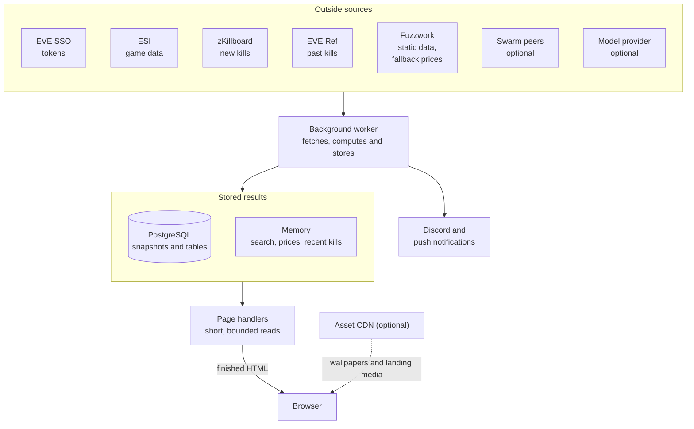

# EveSynapse (Go rewrite)

EveSynapse is a lightweight and fast, yet comprehensive and powerful all-in-one EVE Online companion (character sheets, market, fitting, intel, industry, etc) rebuilt in Go on CCP/Fenris Creation's ESI API with EVE SSO login.

The modernization is developed by natemsz (Nate / IGN: Burzrujat), rewriting the original Python-based closed-source app module by module in Go. All modules have been rewritten as of November 12th, 2026. Built in the hopes it might be useful to the players of this game that holds a special place in my heart and other third party developers for their own projects.

EveSynapse is based on the 2013 project originally developed by natemsz, element, and j0ker (Rest in peace Matt. See you on the other side of the Eve Gate). Without them, the original project would not have been possible and this rewrite would not exist. While they have not contributed to the modernization, their work was critically important to both it's development and to my skills as a developer today. 

Special thanks to Sahir and ado for helping me fix my own mistakes and answering questions, and to Marti for putting up with me and my constant requests to test out features.

This project is dedicated to EVE Online, the game and community that I have loved for over two decades. To its pilots and its developers, past, present, and future; and to all those who we have lost over the years o7.

While there is a hosted version (https://evesynapse.app) you are welcome to install this on your local machine or as a corporation/alliance service (see below on how to restrict sign-ups). If you have suggestions, concerns, questions or complaints, feel free to shoot us an email.

Contact: admin@evesynapse.app (the team), nate@evesynapse.app (Nate, or in-game 'Burzrujat'), miko@evesynapse.app (Miko). Bugs, issues and security reports go to bugs@evesynapse.app (see SECURITY.md).

## Repository

The project's main home is on Forgejo at [natems.dev/EveSynapse/evesynapse](https://natems.dev/EveSynapse/evesynapse). Development, issues, and pull requests happen there. The project is mirrored at [GitHub](https://github.com/natemsz/evesynapse) and [GitLab](https://gitlab.com/natemsz/evesynapse); the mirrors are read-only copies and may lag the main home.

## Guiding principles

- **Depth and variety both.** We don't sacrifice depth for variety. We spend the extra time to do both.
- **Accurate data is the altar.** Prices come from EveSynapse's own swept orders and stored estimates, with a clearly labeled outside fallback only where our own data has a gap, and an honest gap where there is no sound figure. We do our own math.
- **Fresh data, fast pages.** What a user is looking at stays fresh, and the user experience does not degrade to save calls or CPU. Work is precomputed at ingest, never at render, and every page reads a bounded set of rows.
- **Lightweight without compromise.** Lean, fast, efficient, and scalable, without compromising features, power, or security.
- **Inspired, never copied.** Another tool can inspire a feature. EveSynapse's version ships only if it is better, faster, smarter, or more integrated than the one that inspired it.
- **Every instance stands on its own.** The swarm is an accelerator where present, never a crutch. An instance budgets its own calls and serves its users by itself.
- **Intel does not guess.** An invented claim filed as fact can move a fleet; a missed claim is only missing data. Precision comes before recall.
- **No Overhead.** We always take the path that leads to the best results, not the fastest prototype. Experience of the user trumps the ease/speed of development every time.

## AI Use Disclosure and Policy
- AI is used in this project purely for security auditing, hardening, and performance improvements, writing tests, certain UI elements such as icons and glyphs (I'm no artist), and to assist with simplifying repetitive tasks. AI is a force multiplier, never a primary un-reviewed author. If you wish to contribute code to the project you must:

1. Understand the code you are submitting. Your name is on it, you are responsible for it.
2. Reviewed it adequately with your own brain. Mistakes are okay, but give it your best effort.
3. Never re-make what can be re-used. Familiarize yourself with the existing code-base first.
4. Keep it consistent. Respect conventions. They are there for a reason. If you think something can be improved and wish to make a large change, please explain why. AI is terrible with this and code submitted this way without explanation will be assumed to be breaking rules 1-3.

This is a human-built project built for other humans, and a labor of love. 

## Stack

- **Go** (module `evesynapse`; see `go.mod`)
- **chi** (`github.com/go-chi/chi/v5`): HTTP router
- **alexedwards/scs v2**: sessions, stored in PostgreSQL via `pgxstore`
- **PostgreSQL 16 or newer** (the live deployment runs 18.6):
  the app's database, reached through **pgx/v5**: every query
  runs on a pgxpool, which also backs the session store
- **sqlc**: type-safe Go generated from hand-written SQL,
  generated against pgx
- **goccy/go-json**: JSON outside the swarm signing paths,
  which stay on the standard library so signed bytes are stable
- **klauspost/compress**: gzip response compression (gzhttp),
  zstd for stored kill details, and brotli for precompressed
  static assets
- **golang.org/x/oauth2**: EVE SSO authorization-code flow
- **github.com/golang-jwt/jwt/v5**: SSO access-token verification
  against CCP's JWKS (issuer `login.eveonline.com`)
- **html/template** + `embed.FS`: server-rendered pages
- **Ferron** (live deployment): reverse proxy in front of the
  app, behind Cloudflare (proxied DNS, Full Strict TLS,
  Authenticated Origin Pulls). Ferron terminates TLS with a
  Cloudflare Origin CA certificate and proxies to the app on
  127.0.0.1:8080.


## Documentation

The user and operator documentation lives in the
[wiki](https://natems.dev/EveSynapse/evesynapse/wiki), organized by topic:
[Features](https://natems.dev/EveSynapse/evesynapse/wiki/Features), [Installation](https://natems.dev/EveSynapse/evesynapse/wiki/Installation),
[Running](https://natems.dev/EveSynapse/evesynapse/wiki/Running), [Configuration](https://natems.dev/EveSynapse/evesynapse/wiki/Configuration),
[Updating](https://natems.dev/EveSynapse/evesynapse/wiki/Updating), [Notifications](https://natems.dev/EveSynapse/evesynapse/wiki/Notifications),
[Discord](https://natems.dev/EveSynapse/evesynapse/wiki/Discord), [Security](https://natems.dev/EveSynapse/evesynapse/wiki/Security), the
[Swarm Cache](https://natems.dev/EveSynapse/evesynapse/wiki/Swarm-Cache), the [Frontend](https://natems.dev/EveSynapse/evesynapse/wiki/Frontend),
[Architecture](https://natems.dev/EveSynapse/evesynapse/wiki/Architecture), and the [Code Layout](https://natems.dev/EveSynapse/evesynapse/wiki/Code-Layout).
This README keeps the project's description, its AI use
disclosure, the stack, and the basics. The wiki has the detail.

## How data moves

EveSynapse gathers and computes data in the background, stores the
result, and serves pages from what is stored. A page load does not
wait on ESI. [Architecture](https://natems.dev/EveSynapse/evesynapse/wiki/Architecture#how-data-moves) covers
each source.



## Asset CDN

`ASSETS_PATH` is optional. Set it to a host that mirrors the
`/static` tree, for example `ASSETS_PATH=cdn.example.com`. Wallpapers
and landing media then load from that host. The default wallpapers
stay in the binary and take over if the host cannot be reached.

Without it, the Full wallpaper option is off, every scheme uses the
default muted wallpaper, and the landing page shows still images. See
[Configuration](https://natems.dev/EveSynapse/evesynapse/wiki/Configuration).

## Layout

The code is in four layers, and imports only point down:

1. **Entry points** (`cmd/`): thin `main` packages: the server, the
   dev server and the maintainer tools.
2. **Core** (`internal/app`): the application: sign-in, routing,
   page rendering, the background worker and every page that is not
   an optional module.
3. **Modules** (`internal/app/<module>/`): the optional features.
   Each one is a package that registers a `module.Module` and reaches
   the rest of the app only through the contract in
   `internal/app/module` (`module.Deps`). A build contains exactly the
   modules `internal/app/modules_enabled.go` imports (see "Choosing
   the modules in a build" below).
4. **Foundation** (`internal/*`): the database, the ESI client and
   the engines and helpers that core and modules share. Most of them
   are pure: no store, no network, no configuration.

Three rules hold across the tree, and a change that breaks one needs a
good reason:

- A module never imports core (`internal/app`) or another module.
  When one module needs another (Public Fits and Doctrines need
  Fitting) it says so in its manifest, and `cmd/modbuild` brings the
  required module into the build; there is no import between them.
- Foundation packages never import `internal/app` or a module.
  `internal/esi` in particular gets its access tokens through a
  callback.
- What core and a module both show lives in foundation (for example
  `internal/ideas` for the stored trade-ideas answer, or
  `internal/fitview` for the fit document), so that neither depends on
  the other.

The file-by-file listing is on the wiki's [Code Layout](https://natems.dev/EveSynapse/evesynapse/wiki/Code-Layout) page, and [Architecture](https://natems.dev/EveSynapse/evesynapse/wiki/Architecture) explains the modules.

## Installing

The recommended way to install EveSynapse is the standalone [EveSynapse Installer](https://natems.dev/EveSynapse/evesynapse-installer) ([latest release](https://natems.dev/EveSynapse/evesynapse-installer/releases/latest)). It handles the binary, PostgreSQL setup, configuration, and service unit interactively. Full instructions and manual setup steps live on the wiki's [Installation](https://natems.dev/EveSynapse/evesynapse/wiki/Installation) page.

## Build from source

Needs Go (the version in `go.mod`). The full build commands are
on the wiki's [Installation](https://natems.dev/EveSynapse/evesynapse/wiki/Installation) page, under
"Build from source".

### Choosing the modules in a build

Every optional feature (the build planner, the fitting tool, the market pages, the corporation pages, Discord, the shared cache, ...) is a module, and a build contains exactly the modules `internal/app/modules_enabled.go` imports. The default file lists them all. To build a smaller server, let the build tool write that file for your selection; whatever a chosen module requires comes along, and the tool prints the ESI scopes the selection will ask players for:

```sh
make modules                                          # every module, what it requires and the scopes it declares
go run ./cmd/modbuild -modules fitting,doctrines      # print the file and the scopes; nothing is written
go run ./cmd/modbuild -modules fitting,doctrines -write
go build -o bin/evesynapse ./cmd/evesynapse
go run ./cmd/modbuild -all -write                     # back to the default, everything
```

`-core-only` is the empty selection (`go build -tags core_only` compiles none regardless of the file). CI checks that the default file is the all-modules selection and that each module builds on its own with what it requires.

To install a custom build or build from source on a server, use the [EveSynapse Installer](https://natems.dev/EveSynapse/evesynapse-installer/releases/latest) or follow the [Installation](https://natems.dev/EveSynapse/evesynapse/wiki/Installation) guide.

## Command-line modes

```sh
evesynapse                          run the web app
evesynapse -version                 print the version and exit
evesynapse -update                  update to the latest release (right build for this machine)
evesynapse -update -arm64           update, fetching the ARM build
evesynapse -update -amd64           update, fetching the Intel/AMD build (-x86, -x64 also work)
evesynapse -update -dev             update to the newest development build
evesynapse -update <url> <sha256>   install a specific build from an address (checksum required)
evesynapse -update <file> [sha256]  install a build from a local file
evesynapse -refresh                 mark all cached data stale (run while the app is stopped)
evesynapse -populate-names          fill in stored corporation and alliance names
evesynapse -seed-demo               create or reset the shared demo account
evesynapse -push-keys               print a new key pair for browser push, as lines for .env
evesynapse -wrap-token-key          wrap the token key with a KMS key and print the result
evesynapse -h                       show this list
```

## How the system works

The wiki holds the detail on each part:

- [EVE SSO Flow](https://natems.dev/EveSynapse/evesynapse/wiki/SSO-Flow): sign-in, scopes and character linking
- [Token Refresh and Caching](https://natems.dev/EveSynapse/evesynapse/wiki/Token-Refresh-and-Caching): token upkeep and stored snapshots
- [Background Worker](https://natems.dev/EveSynapse/evesynapse/wiki/Background-Worker): what is fetched, and when
- [Static Data](https://natems.dev/EveSynapse/evesynapse/wiki/Static-Data): the SDE import
- [Database](https://natems.dev/EveSynapse/evesynapse/wiki/Database): PostgreSQL, schema steps and sqlc
- [Logging](https://natems.dev/EveSynapse/evesynapse/wiki/Logging): levels and formats
- [Performance Principles](https://natems.dev/EveSynapse/evesynapse/wiki/Performance-Principles): how data moves through the app
- [Dev Login](https://natems.dev/EveSynapse/evesynapse/wiki/Dev-Login): the dev build's sign-in shortcut
